  
  
  
  

### About me 🌷

- Computer Science at **[UC San Diego](https://ucsd.edu)**, graduating Dec 2027
- Specializing in backend systems, with a research interest in **tail latency across multi-tier systems**, especially pipelines where AI models and agents sit on the critical path
- Currently:
  - **AIDE** at CSES Innovate: voice-to-code for VS Code (**3–5 min → 2–5 s**, CPU only); now writing the research paper and running the study
  - Prev. full-stack SWE at **Y STEM and Chess**, summer '26

---

### Things I've built 🛠️

  
  
  
  

🔍 <b>How they work under the hood</b>

 

**[LitSynth](https://github.com/sanjana1976/LitAgent_Phase2)**: an autonomous research agent. It breaks a question into sub-queries, searches arXiv, Semantic Scholar, DBLP and Crossref in parallel, extracts each paper's claims and flags where sources contradict each other. It runs as a checkpointed LangGraph state machine that fans retrieval, extraction and contradiction checks across workers (6.5 min → ~70 s). A writer/critic loop retracts any claim that fails a citation whitelist.

**[Downstream](https://github.com/sanjana1976/PR_Check)**: builds a monorepo's module dependency graph and walks reverse import edges to find everything a PR can break and who should review it. It parses with oxc-parser and resolves imports itself (tsconfig paths, workspaces, package exports) with zero I/O in the core. Edges are stored in compact CSR arrays, and 12 golden fixtures pin it to the TypeScript compiler's own resolver.

**[Menu Buddy](https://github.com/sanjana1976/menu-translator)**: React + Express. Menu photos go through a vision-model extraction pipeline with a strict JSON schema. Results are cached by image hash, so a repeat scan is instant and free. The API layer adds request IDs, upload validation, timeouts and rate limiting.

**[Smart Document Search](https://github.com/sanjana1976/RAG-pipeline)**: transcripts are chunked, embedded with gte-small and shortlisted from a FAISS index, then re-ranked with ColBERT-style token-level scoring on BERT. That catches matches pooled embeddings miss.

---

### GitHub stats 📊

  
  

<picture>
  <source media="(prefers-color-scheme: dark)" srcset="https://raw.githubusercontent.com/sanjana1976/sanjana1976/output/snake-dark.svg">
  <source media="(prefers-color-scheme: light)" srcset="https://raw.githubusercontent.com/sanjana1976/sanjana1976/output/snake-light.svg">
  
</picture>

🧰 <b>Full toolbox</b>

 

   
  

plus LangGraph · Hugging Face · FAISS · Socket.io · Stripe · pytest · Vitest · JUnit

  ask me about: shaving p99s · why your webhook fired twice · fan-out vs. one big prompt

<code>$ curl whoami</code>

 

  

